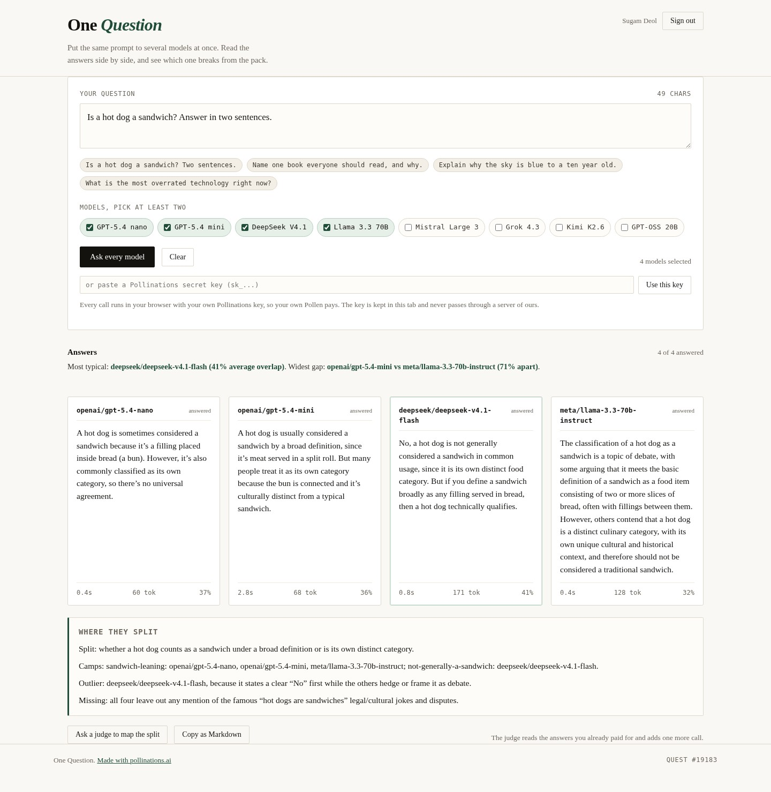

# One Question

Ask several AI models the same question at once and read the answers side by side, with the
latency and token count each one spent, and a plain measure of how far each answer sits from
the pack.

Live app: https://sugamdeol.github.io/one-question/

## What it does

Every model has a house style. Put them on the same prompt and the differences stop being
abstract: one hedges, one gives a verdict in six words, one writes four paragraphs and never
answers. One Question runs your prompt across a spread of labs in parallel, one card per model,
then ranks the cards by how much they overlap with the rest.

- **Ask once, read many.** The page sends your question to every model you tick, at the same
  time, through one API call shape: `POST https://gen.pollinations.ai/v1/chat/completions`.
- **Measure the agreement.** Each answer is compared to the others by word overlap over content
  words (Dice coefficient, stop words removed). The card header shows the average overlap, the
  best-fitting answer is outlined, and a one-line summary names the most typical answer and the
  widest gap between two models.
- **Judge on demand.** One extra click asks a model to read the answers and name the question
  they actually disagree about, which camp each model falls in, and what all of them left out.
- **Export.** Copy every answer plus the judge's reading as Markdown, one section per model.

## Your own Pollen pays

Sign in with Pollinations (OAuth code flow with PKCE, public app key `pk_yLPV9dPlAHJ9LNyj`), or
paste your own `sk_` key. The resulting key lives in this tab's `sessionStorage` only, is sent
to `gen.pollinations.ai` and nowhere else, and every model call is billed to your balance.
There is no server of ours and no shared key.

## Run it

Open `index.html`. No build step, no dependencies, no bundler. `app.js` holds everything; the
OAuth redirect URI is this same page, so the callback needs no second page.

## Quest

Built for Pollinations quest #19183: an app about asking many AI models the same question,
built on Pollinations models, with users paying with their own Pollen.
